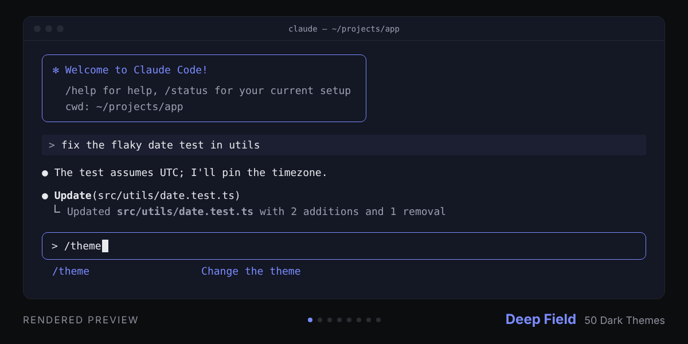

# 50 dark themes for Claude Code

[](https://github.com/notgabriels-sys/claude-code-50-dark-themes/actions/workflows/verify.yml)
[](LICENSE)

**Free dark themes for Claude Code's `/theme` picker: 50 in the main pack, 12 more in Vol. 2.**

Every palette is contrast-checked against its terminal background and has a matched terminal color scheme.

<picture>
  <source media="(prefers-reduced-motion: reduce)" srcset="assets/hero.png">
  
</picture>

## <span id="quick-install--claude-code-plugin"></span>Install

Needs Claude Code v2.1.118 or later (`claude update`). Two commands, typed inside Claude Code,
install the 50; one more adds Vol. 2.

1. Add the marketplace:

   ```text
   /plugin marketplace add notgabriels-sys/claude-code-50-dark-themes
   ```

2. Install the pack:

   ```text
   /plugin install 50-dark-themes@notgabriels-themes
   ```

3. Optional, for the 12 Vol. 2 themes:

   ```text
   /plugin install dark-themes-vol-2@notgabriels-themes
   ```

Restart Claude Code, then run `/theme` and pick one: plugin themes load when it starts.

**→ Every theme, previewed: [gabs-utilities.com/theme/](https://gabs-utilities.com/theme/)** (a page for each of the 62, with a specimen in its own colors).

## Other ways to install

These are themes for the Claude Code CLI. The chat app (claude.ai / desktop) only supports
Light / Dark / System, so every route below puts them into Claude Code. Step-by-step install,
terminal background and troubleshooting guide:
<https://gabs-utilities.com/claude-code-theme-install-guide.html>

### From your terminal

The same plugin install, run outside Claude Code:

```bash
claude plugin marketplace add notgabriels-sys/claude-code-50-dark-themes
claude plugin install 50-dark-themes@notgabriels-themes
```

If Claude Code was open while you installed, restart it first: plugin themes load when it starts.
Then run `/theme` and pick one. The plugin keeps the pack together and makes updates available
through the marketplace. Press `Ctrl+E`
on a plugin theme if you want an editable copy in `~/.claude/themes/`.

### From the zip

Prefer a zip to a `git clone`? The same 50 themes are a **free download** on the
**[v1.0.1 GitHub release →](https://github.com/notgabriels-sys/claude-code-50-dark-themes/releases/tag/themes-plugin-v1.0.1)**
(`claude-code-dark-themes-v1.0.1.zip`). The plugin route above is the recommended install.

### With `install.sh`

```bash
git clone https://github.com/notgabriels-sys/claude-code-50-dark-themes
cd claude-code-50-dark-themes && ./install.sh
```

Then run `/theme` in Claude Code and pick one. If `~/.claude/themes/` didn't exist before,
restart Claude Code once first; the installer tells you when.

```bash
./install.sh --list            # show the 50 names
./install.sh acid deep-field   # install only those
./install.sh --uninstall       # remove them all again
./install.sh --uninstall acid  # remove only those
```

It copies into `~/.claude/themes/`, and if a file of the same name is already there with
different contents it is backed up once as `<name>.json.bak` before being replaced.
`--uninstall` removes the themes and leaves the backups alone. A name that isn't in the
pack stops the run before anything changes.

### By copying the files

```bash
git clone https://github.com/notgabriels-sys/claude-code-50-dark-themes
mkdir -p ~/.claude/themes
cp claude-code-50-dark-themes/*.json ~/.claude/themes/
```

Or copy only the `.json` files you want. In Claude Code, run `/theme`: each file appears in the
list by name. Edits to the files hot-reload, no restart needed (if `~/.claude/themes/` didn't
exist before, restart Claude Code once).

### With an agent

The **[Claude Code Theme Setup Assistant](https://agensi.io/skills/claude-code-theme-setup-assistant)** (on Agensi)
picks a theme with you, installs it, checks it shows in `/theme` and gives you the matching terminal
background. The themes themselves stay free here.

## Matching terminal colors

Every one of the 62 themes also has a matched terminal color scheme (background, foreground, cursor,
selection and the 16 ANSI colors) for iTerm2, Ghostty, kitty, Alacritty, WezTerm, Windows Terminal,
VS Code, Warp, Konsole and Terminal.app, so your prompt, `git` and `ls` match Claude Code. Files and
setup steps: [terminal-schemes/README.md](terminal-schemes/README.md).

## What each file sets

- `claude` + shimmer: brand accent (spinner, assistant label) = theme accent
- `text` / `inactive` / `subtle`: foreground, readable secondary text, and the faintest tier of secondary text
- `promptBorder`, `suggestion`, `rate_limit_fill`: accent-matched
- `permission`, `planMode`: second accent where the theme has one
- `userMessageBackground` (+hover): raised surface, one step above the theme `bg`

Left at the base `dark` preset on purpose: `success`, `error`, `warning`, diff colors —
so status colors stay semantically green/red/yellow in every theme.

The repository verifier checks each palette against its recommended terminal background:
AAA contrast for primary text, AA for foreground accents and readable secondary text, and the
WCAG non-text floor for functional borders and indicators. `permission` and `planMode` are held
to that non-text floor too. Claude Code's token reference describes `permission` as dialog
borders and `planMode` as the plan-mode accent, messages and dialogs, but both colour text:
`planMode` draws the "⏸ plan mode on" status and plan titles such as "Plan to implement", and
`permission` draws dialog titles such as "Permissions" and notices such as "Retrying…". Nine of
the 62 themes keep that text below AA, down to 3.01:1 in Acid. `subtle` is not checked, and these
themes keep it very faint. Claude Code draws text in it far more than borders: rejection
notices ("User rejected Claude's plan:"), sandbox and settings notices, usage statistics and
key hints. With this pack installed that text reads at low contrast.

## Note on backgrounds

Claude Code cannot set your terminal's background color — the terminal app owns that.
For the full effect, set your terminal background to the theme's `bg` hex
(listed in the gallery page, e.g. Graphite = #1D1E20).

### Transparent terminals

Claude Code paints `userMessageBackground` opaquely — it does not inherit your terminal's
transparency. So these themes set it one step *above* the theme `bg` rather than equal to it.
On a transparent terminal the user-message block then reads as a deliberately raised panel,
instead of an opaque patch in the exact color of the background you can otherwise see through.
On an opaque terminal it just reads as a subtle raised surface.

## Same palettes, on the web

These 50 palettes also ship as a set of dark website templates — portfolio, SaaS landing,
docs, pricing, changelog, waitlist, link-in-bio and a résumé, each a single `index.html`
with no build step. **[Live demo →](https://notgabriels-sys.github.io/dark-html-templates-demo/)**

## The 50 themes

Each name opens the theme's own page: a specimen, the install commands, its palette and the measured contrast.

<!-- theme-links:fifty:start -->

[Absinthe](https://gabs-utilities.com/theme/absinthe/) · [Acid](https://gabs-utilities.com/theme/acid/) ·
[Amber Room](https://gabs-utilities.com/theme/amber-room/) · [Anaglyph](https://gabs-utilities.com/theme/anaglyph/) ·
[Blackout](https://gabs-utilities.com/theme/blackout/) · [Blueprint](https://gabs-utilities.com/theme/blueprint/) ·
[Cassette](https://gabs-utilities.com/theme/cassette/) · [Clay](https://gabs-utilities.com/theme/clay/) ·
[Cobalt Hour](https://gabs-utilities.com/theme/cobalt-hour/) · [Concrete](https://gabs-utilities.com/theme/concrete/) ·
[Coral](https://gabs-utilities.com/theme/coral/) · [Crossfade](https://gabs-utilities.com/theme/crossfade/) ·
[Deep Field](https://gabs-utilities.com/theme/deep-field/) · [Dubplate](https://gabs-utilities.com/theme/dubplate/) ·
[Ember](https://gabs-utilities.com/theme/ember/) · [Fathom](https://gabs-utilities.com/theme/fathom/) ·
[Fjord](https://gabs-utilities.com/theme/fjord/) · [Furnace](https://gabs-utilities.com/theme/furnace/) ·
[Glacier](https://gabs-utilities.com/theme/glacier/) · [Graphite](https://gabs-utilities.com/theme/graphite/) ·
[Greenhouse](https://gabs-utilities.com/theme/greenhouse/) · [Harbor](https://gabs-utilities.com/theme/harbor/) ·
[Hearth](https://gabs-utilities.com/theme/hearth/) · [Ink](https://gabs-utilities.com/theme/ink/) ·
[Iris](https://gabs-utilities.com/theme/iris/) · [Lagoon](https://gabs-utilities.com/theme/lagoon/) ·
[Lichen](https://gabs-utilities.com/theme/lichen/) · [Moss](https://gabs-utilities.com/theme/moss/) ·
[Mulberry](https://gabs-utilities.com/theme/mulberry/) · [Nachtschicht](https://gabs-utilities.com/theme/nachtschicht/) ·
[Night Vision](https://gabs-utilities.com/theme/night-vision/) · [Nightshade](https://gabs-utilities.com/theme/nightshade/) ·
[Off Air](https://gabs-utilities.com/theme/off-air/) · [Orchid](https://gabs-utilities.com/theme/orchid/) ·
[Oxide](https://gabs-utilities.com/theme/oxide/) · [Petrol](https://gabs-utilities.com/theme/petrol/) ·
[Plasma](https://gabs-utilities.com/theme/plasma/) · [Signal Red](https://gabs-utilities.com/theme/signal-red/) ·
[Sonar](https://gabs-utilities.com/theme/sonar/) · [Soot](https://gabs-utilities.com/theme/soot/) ·
[Static](https://gabs-utilities.com/theme/static/) · [Terminal](https://gabs-utilities.com/theme/terminal/) ·
[Tidepool](https://gabs-utilities.com/theme/tidepool/) · [Tungsten](https://gabs-utilities.com/theme/tungsten/) ·
[Ultraviolet](https://gabs-utilities.com/theme/ultraviolet/) · [Undergrowth](https://gabs-utilities.com/theme/undergrowth/) ·
[Undertow](https://gabs-utilities.com/theme/undertow/) · [VU Meter](https://gabs-utilities.com/theme/vu-meter/) ·
[Velvet](https://gabs-utilities.com/theme/velvet/) · [Verdigris](https://gabs-utilities.com/theme/verdigris/)

<!-- theme-links:fifty:end -->

## The 12 Vol. 2 themes

<!-- theme-links:vol2:start -->

[Afterglow](https://gabs-utilities.com/theme/afterglow/) · [Aurora Borealis](https://gabs-utilities.com/theme/aurora-borealis/) ·
[Basalt](https://gabs-utilities.com/theme/basalt/) · [Biolume](https://gabs-utilities.com/theme/biolume/) ·
[Cryosleep](https://gabs-utilities.com/theme/cryosleep/) · [Darkroom](https://gabs-utilities.com/theme/darkroom/) ·
[Gaslight](https://gabs-utilities.com/theme/gaslight/) · [Heliotrope](https://gabs-utilities.com/theme/heliotrope/) ·
[Magnetite](https://gabs-utilities.com/theme/magnetite/) · [Monsoon](https://gabs-utilities.com/theme/monsoon/) ·
[Neon Noir](https://gabs-utilities.com/theme/neon-noir/) · [Ozone](https://gabs-utilities.com/theme/ozone/)

<!-- theme-links:vol2:end -->

A separate free plugin in the same marketplace, held to the same contrast floors.
Preview them all: [plugins/dark-themes-vol-2/preview.png](plugins/dark-themes-vol-2/preview.png)
or in the [gallery's expansion section](https://gabs-utilities.com/#vol2).

```bash
claude plugin install dark-themes-vol-2@notgabriels-themes
```

If Claude Code was open while you installed, restart it: plugin themes load when it starts.


## Familiars: Claude skills for sound work

**Familiars** is the catalogue these themes sit in, at https://gabs-utilities.com/familiars.html : Claude
skills and plugins built in a Berlin studio for people who make and deliver sound. Each one has a
form, a name and one narrow job, works inside your specs instead of inventing sample rates or
loudness targets, and keeps what you said apart from what it inferred. Six are in early access by
email (track finishing, release concepts, audio evaluation, mix and master reports, studio German,
and a studio ops plugin that covers a techno studio from demo triage to the tech rider); the dark
theme is public under MIT.

## More dark tools

Same palettes and the same care, applied elsewhere. All one-time purchases, no
subscriptions, and none of it needed to use the themes above.
The whole catalog, previewed: **[gabs-utilities.com](https://gabs-utilities.com/)**.

<details>
<summary>Twelve published packs plus one résumé demo — UI kit, HTML templates, app screens, email, business documents, social, cheatsheets, keycaps, wallpapers, palettes</summary>

| | |
|---|---|
| **[Dark UI Kit](https://notgabriel.gumroad.com/l/ckthsb)** — one CSS file, no build step | buttons, forms, cards, tabs, modal · €12 |
| **[Dark HTML Templates](https://notgabriel.gumroad.com/l/cfcvmy)** — 8 single-file pages | portfolio, SaaS, docs, pricing · $19 |
| **[Dark App Screens](https://notgabriel.gumroad.com/l/dark-app-screens)** — 6 product screens + 50 themes | sign-in, dashboard, data table, settings, inbox, error pages · €14 |
| **[Dark Email Templates](https://notgabriel.gumroad.com/l/xjcbji)** — transactional email | welcome, receipt, reset, OTP · €9 |
| **[Dark Invoice & Business Documents](https://notgabriel.gumroad.com/l/dark-invoice-business-documents)** — 9 print-ready HTML documents | invoice, quote, receipt, credit note, purchase order and more · €12 |
| **[Social & OG Templates](https://notgabriel.gumroad.com/l/bunkhy)** — exact-size share images | OG cards, X header, thumbnails · €9 |
| **[Résumé & CV Templates — live demo](https://notgabriels-sys.github.io/dark-html-templates-demo/resume/)** — prints clean to PDF | 5 layouts + cover letter · checkout temporarily withheld |
| **[Dev Cheatsheets](https://notgabriel.gumroad.com/l/kxsfa)** + **[Vol. 2](https://notgabriel.gumroad.com/l/kykega)** | git, vim, tmux, SQL, CSS, HTTP · €7 each |
| **[Keyboard Shortcuts](https://notgabriel.gumroad.com/l/wgtbkq)** — keycap reference cards | VS Code, macOS, Vim, tmux · €7 |
| **[Dark Wallpapers](https://notgabriel.gumroad.com/l/bqgfv)** + **[Vol. 2 · Aurora](https://notgabriel.gumroad.com/l/jqrdfy)** | 4K, desktop & mobile · from €6 |
| **[50 Dark Palettes](https://notgabriel.gumroad.com/l/xcxeb)** — for designers & devs | CSS, SCSS, Tailwind, .ase, .gpl · $9 |

</details>

**[Everything Dark — the complete kit →](https://notgabriel.gumroad.com/l/wuhehk)** (published dark-asset bundle, $39)

### More free things

- **[Lowlight — 70 VS Code themes](https://github.com/notgabriels-sys/lowlight-themes)** — fifty dark, twenty light, same contrast discipline. MIT.
- **[Dark Terminal Themes](https://github.com/notgabriels-sys/dark-terminal-themes)** — the same fifty for Alacritty, kitty, Ghostty, WezTerm, iTerm2 and Windows Terminal. MIT.
- **[Deep Field for Obsidian](https://github.com/notgabriels-sys/obsidian-deep-field)** — one of the fifty, free and standalone. MIT.

### The contrast tool, free

**[theme-contrast](https://github.com/notgabriels-sys/theme-contrast)** — one Python file, no
dependencies, checks any theme against WCAG floors and exits non-zero in CI. It knows the
difference between body text, accents, UI marks and surfaces, so it does not bury the real
failures under false positives. MIT.

```bash
python3 theme_contrast.py themes/
```

### How these are built

**[What 50 dark Claude Code themes taught me about semantic terminal colors](https://gabs-utilities.com/semantic-terminal-colors.html)**
— why decorative accents can move while errors, warnings, success states and diffs keep their meaning.

**[Every one of my 50 themes failed a contrast check](https://notgabriels-sys.github.io/dark-templates-demo/writing/contrast-floors.html)**
— what the floors are, why a naive check is worse than none, and the fix.

### See them running first

**[Live demos →](https://notgabriels-sys.github.io/dark-templates-demo/)** — business documents,
slide decks and app screens, running in your browser. No signup, nothing to download.
The [HTML templates demo](https://notgabriels-sys.github.io/dark-html-templates-demo/) is separate.

---

Themes in this repo are free and stay free — MIT. If they saved you some fiddling,
a ⭐ helps other people find them.

Contributions are welcome. Read [CONTRIBUTING.md](CONTRIBUTING.md) before adding or changing a theme;
the repository verifies the theme schema, gallery parity, installation command and payment links on
every pull request and every push to `main`.
