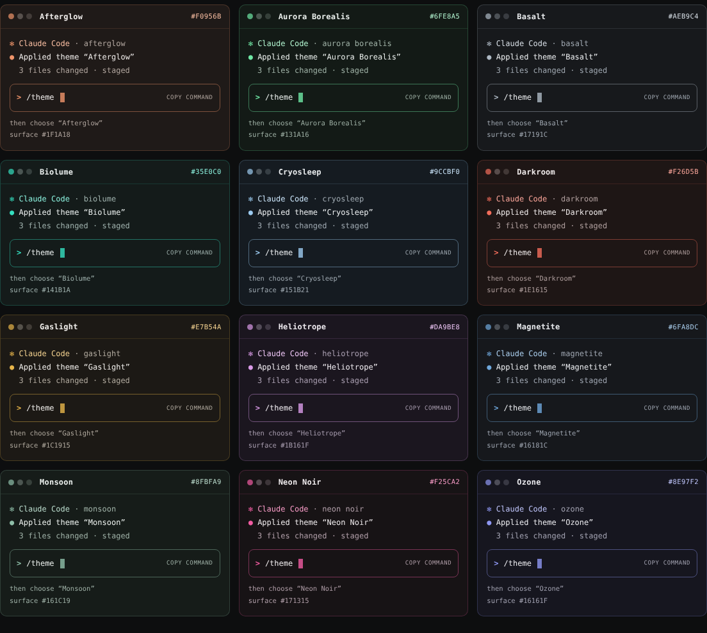

# Dark Themes Vol. 2 for Claude Code

Twelve new hand-tuned dark themes that expand the original
[50 Dark Themes](https://github.com/notgabriels-sys/claude-code-50-dark-themes) pack, with
all-new palettes. Each recolors the accent, the text and the surfaces around them, and leaves the
success, error, warning and diff colors to Claude Code's own dark preset, as the first pack does.
Every palette is checked in CI against role-aware contrast floors: WCAG AAA for primary text, AA
for secondary text, and the non-text floor for borders and indicators. Free and MIT licensed.



```text
/plugin marketplace add notgabriels-sys/claude-code-50-dark-themes
/plugin install dark-themes-vol-2@notgabriels-themes
```

Run `/theme` and select any theme from the pack. Plugin themes are read-only; press `Ctrl+E` on one
to copy it into `~/.claude/themes/` for editing.

## The themes

<!-- theme-links:vol2-table:start -->

| Theme | Mood |
|---|---|
| [Afterglow](https://gabs-utilities.com/theme/afterglow/) | Warm peach dusk after the sun drops |
| [Aurora Borealis](https://gabs-utilities.com/theme/aurora-borealis/) | Mint-green light over a black sky |
| [Basalt](https://gabs-utilities.com/theme/basalt/) | Cooled volcanic stone, steel-gray monochrome |
| [Biolume](https://gabs-utilities.com/theme/biolume/) | Bioluminescent teal in deep water |
| [Cryosleep](https://gabs-utilities.com/theme/cryosleep/) | Pale ice-blue stasis chamber |
| [Darkroom](https://gabs-utilities.com/theme/darkroom/) | Photographic safelight red-amber |
| [Gaslight](https://gabs-utilities.com/theme/gaslight/) | Victorian gas-lamp amber |
| [Heliotrope](https://gabs-utilities.com/theme/heliotrope/) | Violet-pink garden at night |
| [Magnetite](https://gabs-utilities.com/theme/magnetite/) | Dark iron with a magnetic blue pull |
| [Monsoon](https://gabs-utilities.com/theme/monsoon/) | Rain-washed green-gray |
| [Neon Noir](https://gabs-utilities.com/theme/neon-noir/) | Magenta signage on wet asphalt |
| [Ozone](https://gabs-utilities.com/theme/ozone/) | Electric periwinkle after the storm |

<!-- theme-links:vol2-table:end -->

Each name above opens the theme's own page: a specimen, the install commands, its palette and the
measured contrast. Visual gallery, with the Vol. 2 section: https://gabs-utilities.com/#vol2

Set your terminal's background to the theme's terminal background, the hex printed on its gallery
card and its page, so the colors read as they were measured.

The plugin adds theme files and nothing else: it runs no code, hooks, commands or servers, and
sends nothing anywhere.

Source and manual installation: https://github.com/notgabriels-sys/claude-code-50-dark-themes

## Use it

1. **Pick a theme.** Run `/theme`, move through the list and press Enter on the one you want.
   Switch again at any time the same way.
2. **Make it your own.** Plugin themes are read-only. Press `Ctrl+E` on one in `/theme` to copy it
   into `~/.claude/themes/`, then edit the copy's colors.
3. **Match your terminal.** Set your terminal's background to the theme's background color, listed
   on each theme's page, so panels and text look as designed. Step-by-step for each terminal:
   https://gabs-utilities.com/claude-code-theme-install-guide.html
4. **Remove it.** Run `claude plugin uninstall dark-themes-vol-2@notgabriels-themes`, then pick another
   theme in `/theme`.

## Troubleshooting

- **The themes aren't in `/theme`.** Custom themes need Claude Code v2.1.118 or later
  (`claude --version`, then `claude update`). Restart Claude Code after installing the plugin.
- **Colors look washed out or gray.** Your terminal background doesn't match the theme, or the
  terminal isn't showing 24-bit color (Terminal.app before macOS 26, and some tmux or SSH setups).
- **"Auto (match terminal)" doesn't pick these themes.** Expected: Auto only switches between
  Claude Code's built-in light and dark themes. Pick a custom theme in `/theme` and it stays selected.

## Support

Questions, bugs and theme requests: https://github.com/notgabriels-sys/claude-code-50-dark-themes/issues

